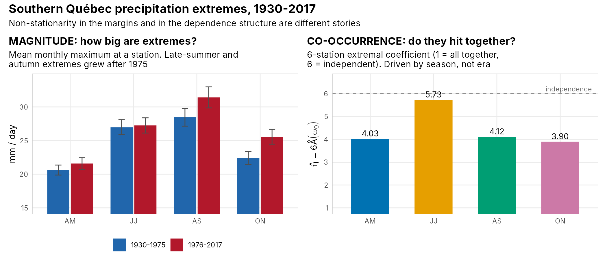
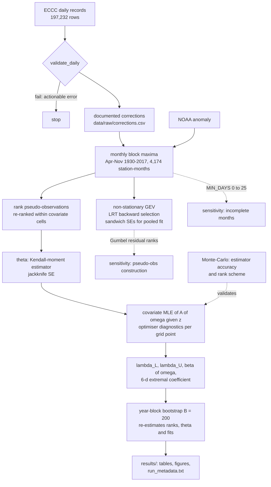
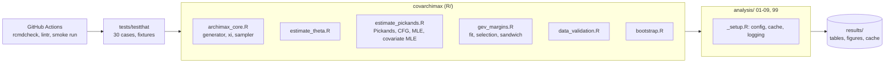
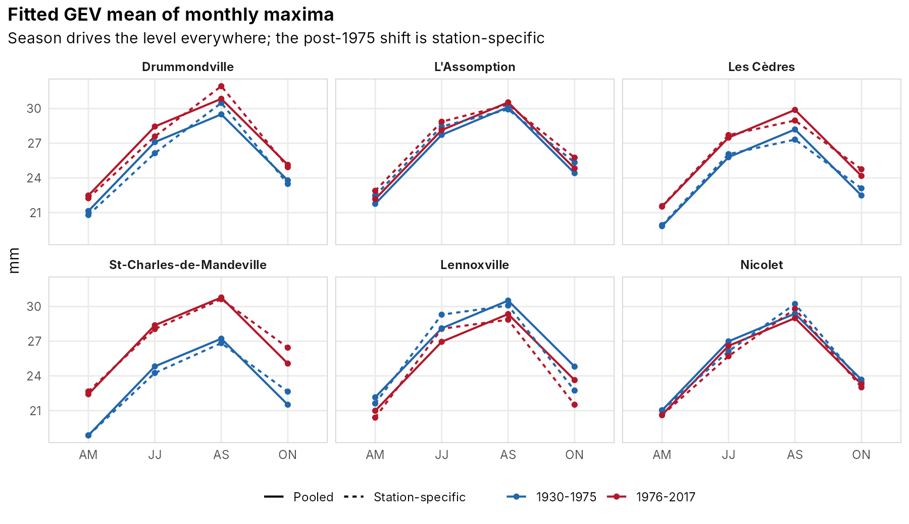
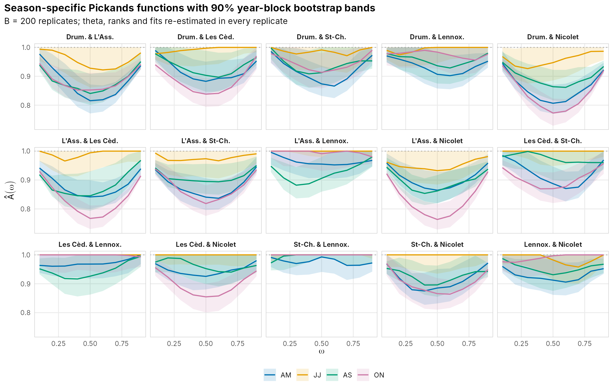
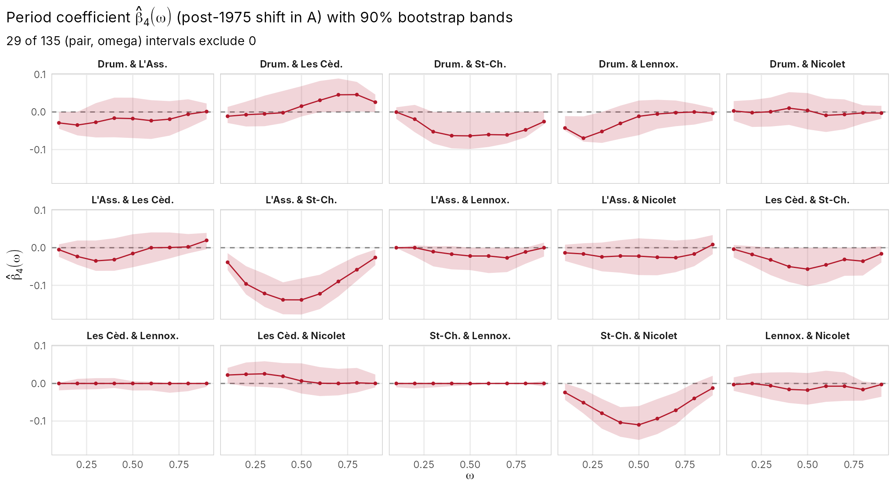
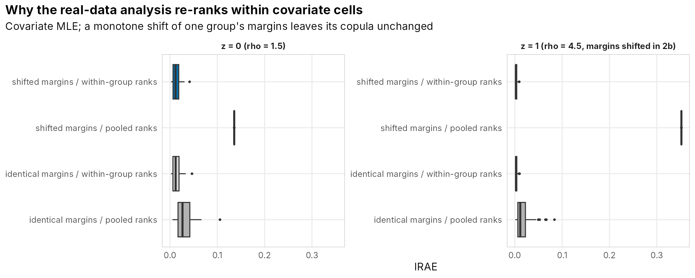

<div align="center">

# covarchimax

### Covariate-Dependent Archimax Copulas for Spatial Extremes

*Applied to 88 years (1930–2017) of precipitation extremes in southern Québec · M.Sc. thesis, McGill 2026*

[](https://github.com/EllenSyuu/SAC-thesis-2026/actions/workflows/ci.yaml)


[](LICENSE.md)

**Ziyi Zhou** · M.Sc. Mathematics & Statistics, McGill University · supervised by Prof. Johanna G. Nešlehová

</div>

<p align="center"></p>

**In one paragraph.** Whether heavy rain hits several places *at the same time* is a different question from how heavy it gets at one place. Regional flood risk depends on both. This repository estimates both for six ECCC stations in southern Québec. Margins are modelled with non-stationary GEV regressions. The joint behaviour is modelled with a Clayton–Archimax copula whose Pickands dependence function depends on covariates, estimated by a new maximum-likelihood method developed in the thesis. The method ships as a tested R package. Every number below comes with an uncertainty statement and is regenerated from raw data by `make all`.

**What the data say** (90 % year-block bootstrap intervals unless stated):

- **Magnitude.** Mean monthly maxima rose after 1975 in August–September (+3.0 mm, Welch p = 0.005) and October–November (+3.2 mm, p < 0.001). In the pooled GEV the post-1975 shift differs by station, ranging from −1.2 mm (Lennoxville) to +3.6 mm (St-Charles).
- **Co-occurrence by season.** Across the six-station network, June–July extremes are close to independent: η̂ = 5.73 (5.23, 6.00) on a scale where 6 means independence. October–November extremes are the most coherent: η̂ = 3.90 (3.60, 4.33). The difference is 1.83 (1.24, 2.28).
- **Co-occurrence by period.** For 12 of 15 station pairs the post-1975 coefficient β̂₄(ω) has intervals covering 0 along most of ω. The exception is the three pairs involving St-Charles-de-Mandeville, whose dependence is *stronger* after 1975. The intervals there exclude 0 over most of ω.

---

## Contents

[Problem](#problem) · [Using the package](#using-the-package) · [Architecture](#architecture) · [Statistical methodology](#statistical-methodology) · [Uncertainty quantification](#uncertainty-quantification) · [Results](#results) · [Validation by simulation](#validation-by-simulation) · [Engineering](#engineering) · [Reproducibility](#reproducibility) · [Limitations](#limitations) · [Future work](#future-work)

## Problem

Classical models for multivariate extremes rely on *extreme-value copulas*. For these data that assumption is rejected for all 15 station pairs (Ben Ghorbal–Genest–Nešlehová test, [table](results/tables/tab_08_ev_dependence_test.csv)), because monthly maxima carry lower-tail dependence that an extreme-value copula cannot represent. Existing semiparametric Archimax inference (Chatelain, Fougères & Nešlehová, 2020) handles that, but has no covariates. Seasonal changes in storm type therefore cannot be represented. The thesis adds covariates to the Pickands dependence function, in the spirit of Mhalla, Chavez-Demoulin & Naveau (2017), and the analysis separates covariate effects on *magnitude* from effects on *co-occurrence*.

## Using the package

The estimators are an installable R package; the thesis analysis in `analysis/` is one client of it.

```r
# install.packages("remotes")
remotes::install_github("EllenSyuu/SAC-thesis-2026", build_vignettes = TRUE)
library(covarchimax)

set.seed(1)
U <- pseudo_obs(rclayton_archimax(500, theta = 0.4, rho = 2))  # simulated pair
th <- estimate_theta(U[, 1], U[, 2])          # Kendall-moment estimator, jackknife SE
pickands_at(U, c(0.5, 0.5), theta = th$theta) # MLE of A(1/2); truth: pickands_logistic(0.5, 2)
vignette("covarchimax")                       # covariate model, diagnostics, bootstrap
```

Every exported function has a help page with a runnable example. The vignette runs on simulated data and takes a few seconds. Changes between versions are listed in [`NEWS.md`](NEWS.md).

## Architecture

**Statistical workflow.** Solid arrows are the default, thesis-faithful path; dotted arrows are robustness and validation branches.



**Code layout.** Estimators live in an installable package; numbered analysis scripts only orchestrate.



## Statistical methodology

Full derivations are in [`docs/methodology.md`](docs/methodology.md).

1. **Margins.** Each station's monthly maxima follow GEV(μ, σ, ξ) with μ ~ period + season and σ ~ season. The structure was chosen by marginality-respecting likelihood-ratio backward elimination, run in both orders as a robustness check ([table](results/tables/tab_04_backward_elimination.csv)). A pooled model with μ ~ period × station + season shares season and shape effects. Because the stations are dependent, its likelihood is a composite likelihood, so Godambe sandwich SEs (clustered by month and by year) are reported alongside the naive ones.
2. **Dependence.** A Clayton–Archimax copula has a generator ψ_θ (lower tail) and a Pickands function A (upper tail). For any ω on the simplex, ξ(ω) = minⱼ φ_θ(Uⱼ)/ωⱼ has survival function ψ_θ(x·A(ω)), so **A(ω) is a scale parameter** with an explicit likelihood:

$$\ell\{\beta(\omega)\} = \sum_i \log a_i - \Big(\tfrac1\theta+1\Big)\log\{1+\theta a_i\hat\xi_i(\omega)\},\qquad a_i = z_i^\top\beta(\omega)\in[\max\omega, 1].$$

   It is maximised separately at each grid point, with an identity link (constrained) or a logit link (unconstrained, bounds automatic).
3. **Generator.** θ is estimated by the Kendall-distribution moment estimator (Chatelain et al. 2020, Eq. 7.4), averaged over the 15 pairs. Pairwise standard errors come from a delete-one jackknife computed in O(n²).
4. **Conditional ranks.** Pseudo-observations are re-ranked inside each covariate cell, so that seasonal shifts in the *margins* are not read as dependence. Study 2b below quantifies why this matters.

## Uncertainty quantification

| Quantity | Method | Where |
|---|---|---|
| GEV coefficients | Wald (inverse observed information); pooled model also Godambe sandwich, clustered by month / year | `tab_05`, `tab_06` |
| Pairwise θ | delete-one jackknife, 90 % Wald | `tab_11` |
| Global θ, η by season, β(0.5), A_JJ − A_ON, β₄(ω), A(ω) bands | **year-block bootstrap**, 90 % percentile | `tab_20`–`tab_24` |
| Estimator accuracy | Monte-Carlo (ISE, IRAE) | `tab_09`, `tab_10*` |

**Bootstrap design.** Resampling 88 calendar years with replacement keeps the six stations and the eight months of each year together, so both spatial and within-year dependence are preserved. Every replicate recomputes the pseudo-observations, θ, and all fits, so the intervals include the uncertainty of θ and of the ranks. Settings: B = 200, seed 20260408 with pre-drawn per-replicate seeds (results do not depend on the core count), ω-grid 0.1, …, 0.9. Runtime is about 10 minutes on 2 cores. Results are cached, keyed on data, parameters and the package code (comments excluded). Inside replicates the optimiser uses one intercept start instead of five; on the original data both settings give identical estimates, a check reported in `tab_23`.

**How to read it.** Percentile intervals are reported as estimated, without multiple-testing adjustment. Across 135 (pair, ω) cells, about 13 intervals at the 90 % level would exclude 0 by chance even with no period effect; 29 do, and they cluster in three pairs. Where the estimate sits on the boundary of the parameter space (A = 1, i.e. tail independence), percentile intervals are not reliable; see [Limitations](#limitations).

## Results

### Margins

| Pooled GEV (baseline: Drummondville, pre-1975, AM) | Estimate | 95 % CI (naive) | 95 % CI (sandwich, month clusters) |
|---|---:|---|---|
| Location: AS vs AM | 5.74 mm | (4.88, 6.61) | (4.23, 7.26) |
| Location: JJ vs AM | 4.48 mm | (3.71, 5.25) | (3.25, 5.71) |
| Location: post-1975, Drummondville | 1.35 mm | (0.08, 2.61) | (0.02, 2.67) |
| Location: post-1975 × St-Charles | 2.22 mm | (0.42, 4.01) | (0.78, 3.65) |
| Location: post-1975 × Lennoxville | −2.51 mm | (−4.30, −0.72) | (−3.99, −1.03) |
| Shape ξ | 0.058 | (0.035, 0.080) | (0.029, 0.086) |

The sandwich correction widens the shared season, scale and shape effects by a factor of 1.3–1.8. It narrows station contrasts, because positively correlated stations partly cancel in differences ([full table](results/tables/tab_06_gev_pooled_coefficients.csv)).

<p align="center"></p>

### Dependence

| | Estimate | 90 % CI |
|---|---:|---|
| Clayton θ (global) | 0.348 | (0.292, 0.457) |
| η, April–May | 4.03 | (3.71, 4.56) |
| η, June–July | 5.73 | (5.23, 6.00) |
| η, August–September | 4.12 | (3.72, 4.73) |
| η, October–November | 3.90 | (3.60, 4.33) |
| η_JJ − η_ON | 1.83 | (1.24, 2.28) |
| η_JJ − η_AM | 1.70 | (0.97, 2.13) |

- **Pairwise season contrast.** A_JJ(½) − A_ON(½) is positive (weaker dependence in early summer) with an interval excluding 0 for **8 of 15 pairs**. The seven exceptions are all five pairs with Lennoxville, where dependence is weak in every season, plus Drummondville with L'Assomption and with St-Charles ([table](results/tables/tab_21_bootstrap_season_beta_w05.csv)).
- **Period effect.** β̂₄(ω) intervals exclude 0 in 29 of 135 cells. 21 of those come from L'Assomption–St-Charles (9/9), St-Charles–Nicolet (6/9) and Drummondville–St-Charles (6/9), all negative, i.e. stronger post-1975 dependence. St-Charles also has the largest post-1975 marginal shift and the most gaps in its record (1961–64, 1997–98). The data cannot separate a climatic cause from a station-history artefact.

<p align="center"></p>
<p align="center"></p>

More figures: [θ by pair](results/figures/fig_07_theta_pairwise.png) · [Kendall's τ](results/figures/fig_05_kendall_tau.png) · [empirical tail dependence](results/figures/fig_05_tail_dependence_curves.png) · [model λ heatmap](results/figures/fig_09_lambda_season_period.png) · [6-d simplex paths](results/figures/fig_11_simplex_paths_6d.png).

### Sensitivity analyses

| Change | Effect on headline quantities | Source |
|---|---|---|
| Drop months with fewer than `MIN_DAYS` valid days (0 → 25; 0 to 95 station-months removed) | θ̂ 0.348 → 0.352; η̂ changes by at most 0.11; AS location 5.74 → 5.86; Drummondville post-1975 shift 1.35 → 1.06 mm | [`tab_18`](results/tables/tab_18_sensitivity_min_days.csv), [figure](results/figures/fig_13_sensitivity_min_days.png) |
| Pseudo-observations from Gumbel residuals of the pooled GEV instead of raw ranks | θ̂ 0.348 → 0.324; η̂ AM/JJ/AS/ON 4.03/5.73/4.12/3.90 → 3.99/5.68/4.06/3.88 | `*_gumbel` tables |
| Elimination order in GEV selection | same model at 5 of 6 stations | `tab_04` |

The defaults reproduce the thesis (`MIN_DAYS = 0`, raw ranks). The alternatives are reported, not substituted.

## Validation by simulation

Clayton–Archimax samples with θ = 0.4 and a logistic Pickands function. Study 1: homogeneous, n = 1000, B = 100. Study 2: binary covariate, ρ = 1.5 vs 4.5, n = 2000, B = 50.

| Mean IRAE (ISE) | Study 1 | Study 2, z = 0 | Study 2, z = 1 |
|---|---:|---:|---:|
| Pickands-type | 0.0430 (2.6e-3) | 0.0661 (5.6e-3) | 0.0502 (2.3e-3) |
| CFG-type | 0.0032 (9.1e-6) | 0.0341 (1.3e-3) | 0.0288 (7.6e-4) |
| MLE | 0.0030 (9.5e-6) | 0.0318 (1.1e-3) | 0.0190 (4.4e-4) |
| MLE, logit link | — | 0.0317 (1.1e-3) | 0.0190 (4.4e-4) |

In the homogeneous case the MLE and CFG estimators are equally accurate: the MLE has the lower IRAE and the CFG estimator the lower ISE. In the thesis design of Study 2 (pseudo-observations ranked over the pooled sample), the covariate MLE has the lowest error in both groups. The logit link is indistinguishable from the constrained identity link. The θ moment estimator averages 0.419 (sd 0.129) against a true value of 0.4 ([`tab_09`](results/tables/tab_09_sim_homogeneous.csv), [`tab_10`](results/tables/tab_10_sim_binary_covariate.csv)).

**Study 2b, rank scheme.** The empirical analysis re-ranks within covariate cells. Study 2b checks whether that matters by shifting the margins of group z = 1 with the monotone transform x ↦ x^{1/3}. The copula is unchanged, as happens when seasons shift the level of precipitation. θ is estimated once from the within-group ranks, so the schemes differ only in the ranks entering ξ(ω).

| Mean IRAE | CFG, z = 0 | CFG, z = 1 | MLE, z = 0 | MLE, z = 1 |
|---|---:|---:|---:|---:|
| identical margins, pooled ranks | 0.034 | 0.029 | 0.032 | 0.019 |
| identical margins, within-group ranks | 0.011 | 0.003 | 0.013 | 0.003 |
| shifted margins, pooled ranks | 0.449 | 0.808 | 0.136 | 0.352 |
| shifted margins, within-group ranks | 0.010 | 0.003 | 0.013 | 0.003 |

Pooled ranks break down as soon as the margins differ between groups: the error rises by one to two orders of magnitude. Even with identical margins they cost accuracy, because another group's observations perturb each group's empirical margins. With within-group ranks, the scheme used for the data, both estimators are accurate and CFG is slightly better than the MLE. The MLE's advantage in Study 2 is therefore mainly robustness to distorted ranks, not a uniform efficiency gain ([`tab_10b`](results/tables/tab_10b_sim_rank_scheme.csv)).

<p align="center"></p>

## Engineering

**Tech stack.** R 4.3 · `extRemes` (GEV) · `copula` · `ggplot2` / `patchwork` / `ragg` · `testthat` · `roxygen2` · `lintr` · `covr` · `renv` · GNU Make · GitHub Actions.

**Key engineering decisions**

| Decision | Reason |
|---|---|
| Estimators in a package, scripts only orchestrate | testable units, one implementation shared by analysis, bootstrap and simulation |
| Raw data versioned in the repo (2.3 MB) and validated on load | offline, deterministic runs; schema drift or a bad download fails loudly ([`validate_daily()`](R/data_validation.R)) |
| Manual corrections declared in `data/raw/corrections.csv` and checked against the raw value before applying | auditable cleaning instead of a silent edit in code |
| No silent failures | optimiser failures return `NA` plus per-grid diagnostics and a warning; failed GEV fits are logged in the selection path; failed bootstrap replicates are counted |
| Thesis-faithful defaults, alternatives behind switches (`MIN_DAYS`, `POBS`) | improvements are visible as sensitivity analyses, not hidden changes to reported numbers |
| Content-addressed cache for expensive steps | `make all` is cheap to rerun; any change to data, parameters or the code in `R/` invalidates the cache (documentation-only edits do not); `make refresh` forces recomputation |
| Per-replicate seeds | Monte-Carlo and bootstrap results are identical on 1 or 64 cores |
| `results/run_metadata.txt` | git SHA, R and package versions, input md5s, parameters and step timings for every full run |

**Quality gates (CI on every push).** `R CMD check` with no warnings allowed, which runs every help-page example, builds the vignette and runs 30 test cases covering estimator correctness, failure paths, data validation, block-bootstrap invariants and GEV selection, with small fixtures rather than the full data. Also a `lintr` gate on `R/`, `tests/` and `analysis/`, a pipeline smoke run (`QUICK=1`, small bootstrap), and an informational coverage report.

## Reproducibility

```bash
git clone https://github.com/EllenSyuu/SAC-thesis-2026 && cd SAC-thesis-2026
Rscript -e 'install.packages("renv"); renv::restore()'   # exact versions from renv.lock

make test        # unit tests
make check       # R CMD check
make cran        # build the tarball and run R CMD check --as-cran
make quick       # smoke run with small Monte-Carlo / bootstrap; writes to results/quick/
make all         # every table and figure (~25 min cold on 2 cores, ~6 min with cache)
make refresh     # ignore the cache and recompute everything
```

- Optional: the station map needs `sf`, `rnaturalearth`, `rnaturalearthdata` and `rnaturalearthhires` (not in the lockfile; the step skips the map if they are missing).
- Switches: `MIN_DAYS=20 make all` applies an incomplete-month filter to the main pipeline. `POBS=gumbel` switches the pseudo-observation construction. `BOOT_B` sets the number of bootstrap replicates.
- Provenance of every input is in [`data/README.md`](data/README.md). Where the code and the thesis text differ, this is recorded in [`docs/reproducibility.md`](docs/reproducibility.md). Every headline thesis table is reproduced, and the deviations found by the rebuild are listed there.

<details>
<summary>Repository layout</summary>

```
├── R/, man/                  covarchimax package (roxygen2 documentation)
├── vignettes/                package vignette (simulated data)
├── tests/testthat/           unit tests + fixtures/
├── analysis/
│   ├── _setup.R                  config, cache, logging, run bookkeeping
│   ├── 01_prepare_data.R         validation, corrections, monthly maxima, EDA
│   ├── 02_marginal_gev.R         GEV selection, station + pooled fits, sandwich SEs, pseudo-obs
│   ├── 03_dependence_eda.R       Kendall tau, tail dependence, EV-dependence test
│   ├── 04_simulation_study.R     estimator accuracy; rank-scheme study 2b
│   ├── 05_archimax_pairwise.R    theta, season x period and season-only models, diagnostics
│   ├── 06_archimax_6d.R          six-station extremal coefficient, simplex paths
│   ├── 08_sensitivity_min_days.R incomplete-month sensitivity
│   ├── 09_bootstrap_ci.R         year-block bootstrap intervals
│   ├── 07_key_findings.R         summary figure
│   └── 99_run_metadata.R         provenance record
├── data/{raw,processed}/     versioned inputs; regenerated intermediates
├── results/{tables,figures,cache}/
├── docs/                     methodology, reproducibility notes
├── renv.lock, Makefile, .github/workflows/ci.yaml
```
</details>

## Limitations

- **Inference for A(ω) is pointwise.** The bootstrap bands are pointwise, not simultaneous; the covariate model is fitted separately at each ω, so the estimate need not be convex in ω and is not guaranteed to be a valid Pickands function between grid points.
- **Boundary estimates.** Many June–July and Lennoxville estimates lie on A = 1 (across both covariate models, 1,488 of 2,970 pair × ω fits have at least one season or period profile on a bound, partly trivially near ω = 0 or 1; [`tab_19`](results/tables/tab_19_optimizer_diagnostics.csv)). The bootstrap is not consistent at a boundary, so intervals touching 1 (e.g. η_JJ up to 6.00) should be read as "compatible with independence", not as calibrated 90 % intervals.
- **Composite likelihood.** The pooled GEV treats stations as independent. Sandwich SEs correct the variance, but the likelihood-ratio tests used for selection are not adjusted (no Satterthwaite or Chandler–Bate correction).
- **Common θ.** A single θ is assumed across pairs and covariates; 14 of 15 pairwise jackknife intervals contain the global θ̂.
- **Fixed design choices.** The 1975 split is chosen from the temperature record, not estimated, and seasons are fixed two-month blocks. Only six stations are used, and pairs that share St-Charles are not independent pieces of evidence.
- **Simulation scope.** Logistic Pickands functions only, one sample size per study, B ≤ 100. With correctly formed (within-group) pseudo-observations, the simulation does not show the covariate MLE to be more accurate than the CFG-type estimator.

## Future work

1. Smooth covariates (temperature anomaly, day of year) through spline or GAM-type models for β(ω), as in Mhalla et al. (2017).
2. Covariate-dependent θ, and a likelihood-based test of a common θ.
3. Shape-constrained (convex, bounded) estimators of A, and simultaneous confidence bands.
4. A larger station network with a spatial model for pair-specific effects; investigate the St-Charles period signal against station metadata.
5. A wider simulation design: non-logistic A, several n, and boundary cases.

## Citation

Please cite the thesis for the method and the analysis. To cite the software, use `citation("covarchimax")` or [`CITATION.cff`](CITATION.cff).

```bibtex
@mastersthesis{zhou2026archimax,
  author = {Zhou, Ziyi},
  title  = {Semiparametric Analysis of Precipitation Extremes in Southern Qu{\'e}bec using Archimax Copulas},
  school = {McGill University, Department of Mathematics and Statistics},
  year   = {2026},
  note   = {Supervisor: Johanna G. Ne{\v{s}}lehov{\'a}}
}

@manual{zhou2026covarchimax,
  author = {Zhou, Ziyi},
  title  = {covarchimax: Covariate-Dependent Clayton-Archimax Copulas for Spatial Extremes},
  year   = {2026},
  note   = {R package version 1.0.0},
  url    = {https://github.com/EllenSyuu/SAC-thesis-2026}
}
```

I am grateful to Prof. Johanna G. Nešlehová for her supervision. Contains information licensed under the [Open Government Licence – Canada](https://open.canada.ca/en/open-government-licence-canada) (Environment and Climate Change Canada historical daily climate data, retrieved with [`weathercan`](https://docs.ropensci.org/weathercan/)). Temperature anomalies: NOAA NCEI *Climate at a Glance* (U.S. Government work, public domain). Code: MIT licence.
