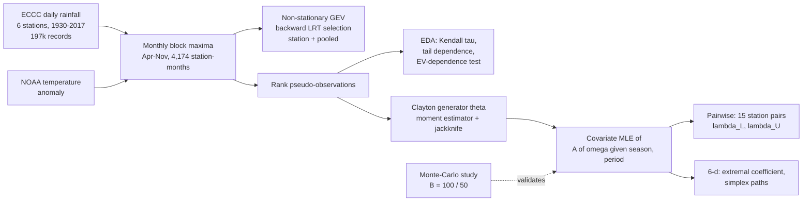
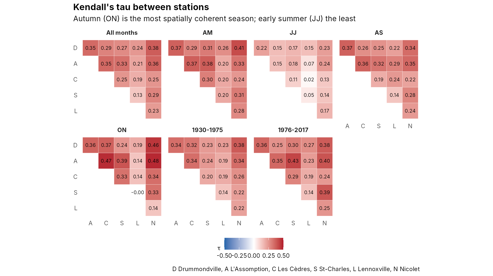
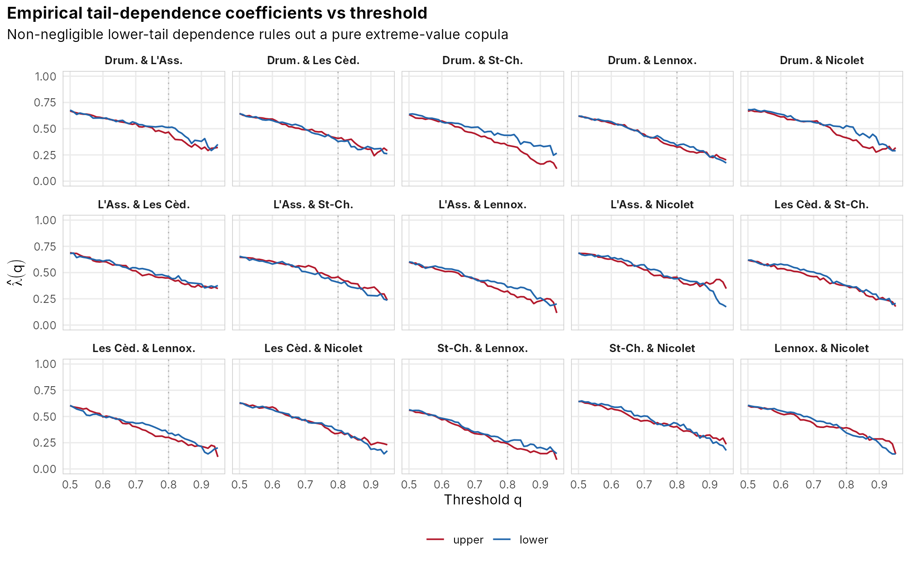
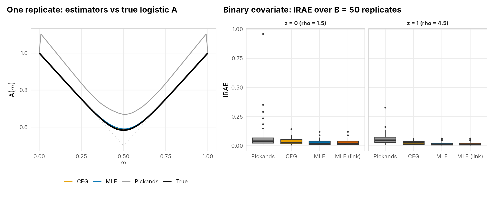
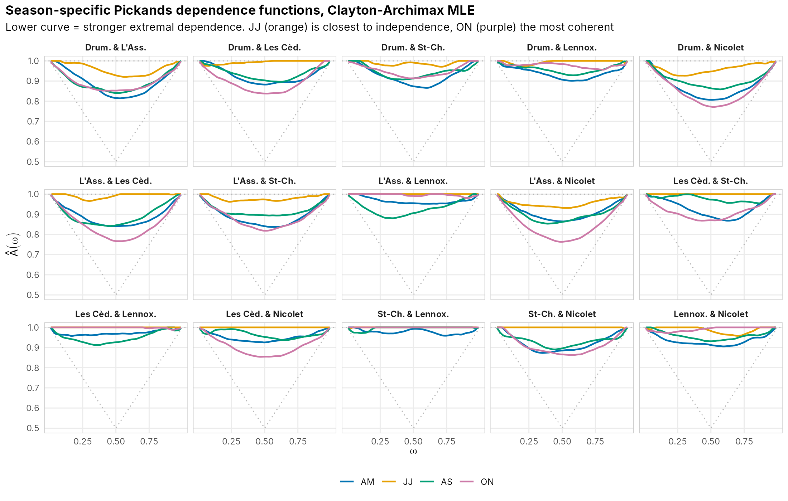
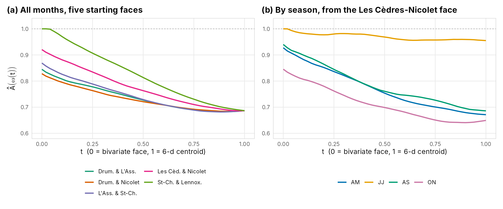

<div align="center">

# Season, not era

### Covariate-dependent Archimax copulas for precipitation extremes in southern Québec

[](https://github.com/EllenSyuu/SAC-thesis-2026/actions/workflows/ci.yaml)


[](LICENSE.md)


**Ziyi (Ellen) Zhou** · M.Sc. Mathematics & Statistics, McGill University · supervised by Prof. Johanna G. Nešlehová

</div>

<p align="center"></p>

> **TL;DR.** Using 88 years of daily rainfall from six ECCC stations, I separate *how large* extreme rainfall gets from *how often extremes hit several places at once*. Magnitudes are non-stationary: late-summer maxima rose by about 3 mm/day after 1975. The spatial co-occurrence of extremes is instead governed by **season**: June–July storms are almost independent across the network (η̂ = 5.7 out of 6), while autumn systems are the most coherent (η̂ = 3.9). To show this I developed a **maximum-likelihood estimator for a covariate-dependent Pickands dependence function** inside the Clayton–Archimax copula. It beats existing estimators in simulation and ships here as a tested R package.

---

## Why this matters

Regional flood and catastrophe risk depends on whether extremes **co-occur**, not just on how extreme each site gets. Two regions with identical marginal return levels can carry very different aggregate losses. Insurers, reinsurers and infrastructure planners therefore model the dependence structure explicitly. Classical extreme-value copulas, however:

1. **assume max-stability**, which is rejected for every one of the 15 station pairs here (lower-tail dependence is present);
2. **have no covariates**, so a seasonal change in storm type cannot be represented.

This project addresses both, combining the semiparametric Archimax framework of [Chatelain et al. (2020, *Ann. Statist.*)](https://doi.org/10.1214/19-AOS1836) with the covariate-modelling idea of [Mhalla et al. (2017, *JMVA*)](https://doi.org/10.1016/j.jmva.2017.05.001).

## Pipeline



## Results

### 1. Margins: extremes got bigger, but not everywhere and not in every season

Non-stationary GEV with location ~ period + season, scale ~ season, constant shape. Selected by backward likelihood-ratio tests; the selection is identical under both elimination orders at 5 of 6 stations ([table](results/tables/tab_04_backward_elimination.csv)).

| Pooled model (Drummondville baseline) | Estimate | 95% CI |
|---|---:|---|
| Location, AS vs AM | **+5.74 mm** | (4.88, 6.61) |
| Location, JJ vs AM | +4.48 mm | (3.71, 5.25) |
| Post-1975 shift, Drummondville | +1.35 mm | (0.08, 2.61) |
| Post-1975 shift, St-Charles (net) | +3.56 mm | interaction +2.22 (0.42, 4.01) |
| Post-1975 shift, Lennoxville (net) | −1.17 mm | interaction −2.51 (−4.30, −0.72) |
| Shape ξ | 0.058 | (0.035, 0.080) |

The tail is mildly heavy (Fréchet-type), and the period effect is **station-specific**: [full coefficients](results/tables/tab_06_gev_pooled_coefficients.csv) · [QQ plot](results/figures/fig_04_pooled_gev_qq.png).

<p align="center"></p>

### 2. Why a new copula model is needed

<table><tr>
<td width="50%"></td>
<td width="50%"></td>
</tr></table>

- Kendall's τ ranges from 0.13 to 0.38 overall. It is highest in **autumn** (up to 0.48) and lowest in **June–July** (at most 0.24).
- Empirical **lower**-tail dependence does not vanish. The extreme-value-dependence test of Ben Ghorbal, Genest & Nešlehová (2009) rejects **15 / 15** pairs ([table](results/tables/tab_08_ev_dependence_test.csv)), so a Clayton–Archimax copula, which allows dependence in both tails, is appropriate.

### 3. The estimator: MLE for a covariate-dependent Pickands function

At each point ω of the unit simplex, the transformed variable ξ(ω) = minⱼ φθ(Uⱼ)/ωⱼ has survival function ψθ(x·A(ω)). A(ω) is therefore a **scale parameter**, which gives the likelihood

$$
\ell\{\beta(\omega)\} = \sum_{i} \log a_i - \Big(\tfrac{1}{\theta}+1\Big)\log\{1+\theta\,a_i\,\hat\xi_i(\omega)\},
\qquad a_i = A(\omega\mid z_i) = z_i^\top\beta(\omega)\in[\max\omega,\,1].
$$

The estimates stay within the Pickands bounds by construction, a logit-link variant removes the constraint, and the same code works in any dimension. Details are in [`docs/methodology.md`](docs/methodology.md).

**Simulation** (Clayton–Archimax, θ = 0.4, logistic A; [study 1](results/tables/tab_09_sim_homogeneous.csv) n = 1000 × B = 100, [study 2](results/tables/tab_10_sim_binary_covariate.csv) n = 2000 × B = 50):

| Mean IRAE | Homogeneous | Binary covariate, z = 0 | Binary covariate, z = 1 |
|---|---:|---:|---:|
| Pickands-type | 0.0390 | 0.0826 | 0.0594 |
| CFG-type | 0.0035 | 0.0353 | 0.0279 |
| **MLE (this work)** | **0.0028** | 0.0282 | 0.0163 |
| **MLE, logit link (this work)** | — | **0.0281** | **0.0162** |

<p align="center"></p>

### 4. Application: season, not era, drives co-occurrence

- **Generator θ.** The pairwise moment estimates range from 0.21 to 0.54 and all 90 % jackknife intervals overlap, so a common θ̂ = 0.35 is used (s = 1/θ̂ = 2.87, τ(ψ) = 0.15) ([table](results/tables/tab_11_theta_pairwise.csv), [plot](results/figures/fig_07_theta_pairwise.png)).
- **Season × period model.** The period coefficient β̂₄(ω) is centred at zero across the 15 pairs × 99 grid points ([histogram](results/figures/fig_08_beta4_histogram.png)), while season effects are systematic ([λ heatmap](results/figures/fig_09_lambda_season_period.png)).
- **Season-only model** (below). JJ curves hug the independence line A = 1. ON (and often AM) are lowest, i.e. most dependent. Pairs involving Lennoxville, in the Appalachian foothills of the Eastern Townships, are the weakest.

<p align="center"></p>

**Six stations jointly.** The extremal coefficient η = 6·Â(ω₀) runs from 1 (all stations together) to 6 (independent):

| Season | AM | JJ | AS | ON | All months |
|---|---:|---:|---:|---:|---:|
| η̂ | 4.03 | **5.73** | 4.12 | **3.90** | 4.12 |

<p align="center"></p>

**Interpretation.** Summer extremes come from localised convective thunderstorms, whereas spring and autumn extremes come from synoptic-scale systems that hit the whole St. Lawrence lowlands. The climate signal after 1975 shows up in *how much* it rains at a site, not in *how widely* extremes co-occur. Regional risk models should therefore let the margins and the dependence evolve separately.

## The `covarchimax` R package

```r
# install.packages("remotes")
remotes::install_github("EllenSyuu/SAC-thesis-2026")
library(covarchimax)

set.seed(1)
U  <- pseudo_obs(rclayton_archimax(1000, theta = 0.4, rho = 3))  # simulate + rank
th <- estimate_theta(U[, 1], U[, 2])                              # theta, jackknife SE, 90% CI
A  <- pickands_curve(U, th$theta, method = "mle")                 # A(w), always admissible

# covariate-dependent A(w | z): one fit per grid point, identity or logit link
z   <- rbinom(1000, 1, 0.5)
fit <- pickands_cov_mle(U, cbind(1, z), th$theta, link = "logit")
```

| Function | Purpose |
|---|---|
| `estimate_theta()`, `estimate_theta_pairs()` | Moment estimator of the Clayton parameter with O(n²) jackknife SE |
| `pickands_at()`, `pickands_curve()` | Pickands-type, CFG-type and MLE estimators of A(ω), any dimension |
| `pickands_cov_mle()` | Covariate model for A(ω \| z), identity (constrained) or logit link |
| `extremal_coefficient()`, `simplex_path()` | Summaries of d-dimensional dependence |
| `tail_dependence_archimax()`, `tail_dependence_empirical()` | Model-implied and empirical λ_L, λ_U |
| `fit_gev()`, `gev_backward()`, `gev_coef_table()`, `gev_to_gumbel()` | Non-stationary GEV margins and marginality-respecting LRT selection |
| `rclayton_archimax()`, `ise()`, `irae()` | Exact sampler and error metrics for simulation |

The package passes `R CMD check` with status OK, has 19 unit tests (bounds, closed-form moments, recovery of θ and A from simulated data, covariate separation) and is lint-clean.

## Reproduce everything

```bash
git clone https://github.com/EllenSyuu/SAC-thesis-2026 && cd SAC-thesis-2026
Rscript -e 'install.packages(c("devtools","rprojroot","extRemes","copula","dplyr","tidyr","readr","ggplot2","patchwork","ragg","sf","rnaturalearth","rnaturalearthdata"))'

make test      # unit tests
make quick     # smoke run of the whole pipeline (~2 min)
make all       # every table and figure (~25 min on 2 cores)
```

Raw data are versioned in [`data/raw`](data/README.md) (ECCC under the Open Government Licence – Canada, NOAA public domain), so the pipeline runs offline. All randomness is seeded.

Rebuilding the thesis from raw data reproduced every headline table. It also surfaced a few places where the code and the thesis text disagree (how the pseudo-observations were built, which standard-error formula was used, one interval that just misses θ̂). These are documented in [`docs/reproducibility.md`](docs/reproducibility.md). `make sensitivity` reruns the copula analysis on GEV-standardised pseudo-observations as a robustness check. The conclusions do not change: θ̂ = 0.32 and η̂ = 3.99 / 5.68 / 4.06 / 3.88 for AM / JJ / AS / ON, giving the same seasonal ordering.

## Repository layout

```
├── R/                        # covarchimax package: estimators, GEV margins, utilities
├── tests/testthat/           # unit tests
├── analysis/                 # numbered, re-runnable pipeline
│   ├── 01_prepare_data.R         daily -> monthly maxima, cleaning, EDA
│   ├── 02_marginal_gev.R         GEV selection, station + pooled fits, pseudo-obs
│   ├── 03_dependence_eda.R       Kendall tau, tail dependence, EV test
│   ├── 04_simulation_study.R     Monte-Carlo comparison of estimators
│   ├── 05_archimax_pairwise.R    theta, season x period and season-only models
│   ├── 06_archimax_6d.R          six-station extremal coefficient, simplex paths
│   └── 07_key_findings.R         summary figure
├── data/                     # raw inputs (versioned) + processed (regenerated)
├── results/{figures,tables}/ # every figure / table in this README
├── docs/                     # methodology and reproducibility notes
├── Makefile                  # make all | quick | test | lint | sensitivity
└── .github/workflows/ci.yaml # R CMD check + pipeline smoke run on every push
```

## Skills demonstrated

**Statistics.** Extreme-value theory (GEV, block maxima, max-stability), copulas (Archimax, Pickands dependence functions, tail dependence), semiparametric and likelihood inference, U-statistics, jackknife, model selection with likelihood-ratio tests, simulation design.
**Engineering.** R package development (roxygen2, testthat, `R CMD check`), reproducible pipelines (Make, seeded parallel Monte-Carlo), CI with GitHub Actions, data provenance and cleaning, publication-quality visualisation with ggplot2.

## Citation

```bibtex
@mastersthesis{zhou2026archimax,
  author = {Zhou, Ziyi},
  title  = {Semiparametric Analysis of Precipitation Extremes in Southern Qu{\'e}bec using Archimax Copulas},
  school = {McGill University, Department of Mathematics and Statistics},
  year   = {2026},
  note   = {Supervisor: Johanna G. Ne{\v{s}}lehov{\'a}}
}
```

## Acknowledgements

I am grateful to Prof. Johanna G. Nešlehová for her supervision. Data: Environment and Climate Change Canada (via [`weathercan`](https://docs.ropensci.org/weathercan/)) and NOAA NCEI *Climate at a Glance*. Copula machinery builds on [`copula`](https://cran.r-project.org/package=copula) and GEV fitting on [`extRemes`](https://cran.r-project.org/package=extRemes).

<sub>MIT licensed.</sub>
